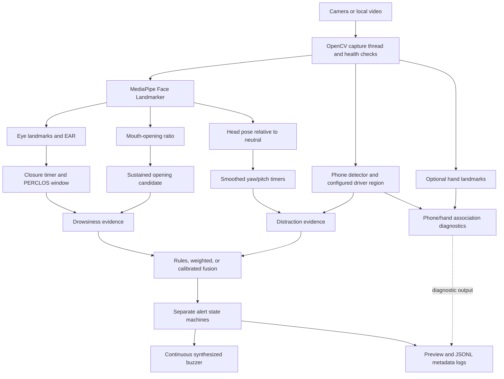

# DriveSentinel


**A local, modular Python prototype for exploring camera-based driver monitoring.** DriveSentinel measures visual cues related to eye closure, sustained mouth opening, head pose, and phone presence, then combines them over time to show monitoring states and provide audio warnings.

> DriveSentinel is a research and demonstration project. It has not been validated as a vehicle safety system, is not safety certified, and should not be relied on while driving.

## Navigation

- [Quick Start](#quick-start)
- [Screenshots and demo](#screenshots-and-demo)
- [Project status](#project-status)
- [Implemented and planned features](#what-is-implemented-and-what-is-planned)
- [What the terms mean](#what-the-terms-mean)
- [How it works](#how-it-works)
- [Technology stack](#technology-stack)
- [Project structure](#project-structure)
- [System requirements](#system-requirements)
- [Installation](#installation)
- [Run and configure](#run-and-configure)
- [Detection behavior](#detection-behavior)
- [Testing and verification](#testing-and-verification)
- [Privacy and run logs](#privacy-and-run-logs)
- [Limitations and future work](#limitations-and-future-work)
- [Contributing and documentation](#contributing-and-documentation)
- [License](#license)

## Quick Start

Use Python 3.11–3.14, a webcam recognized by OpenCV (or a local video), and an audio output device for audible warnings. The steps below work on supported macOS, Linux, and Windows systems; check [System requirements](#system-requirements) first.

Clone the project:

```sh
git clone https://github.com/anantkumarc/DriveSentinel.git
cd DriveSentinel
```

Create and activate a virtual environment. Choose the commands for your system:

```sh
# macOS or Linux
python3.11 -m venv .venv
source .venv/bin/activate
```

```powershell
# Windows PowerShell
py -3.11 -m venv .venv
.venv\Scripts\Activate.ps1
```

With the environment active, install, download the verified model files, and run:

```sh
python -m pip install --upgrade pip
python -m pip install -e .
drive --download-models --all
drive
```

This downloads the required face model and optional phone and hand models for the full profile. To download only the required face model, use `drive --download-models`. Check files later with `drive --check-models`. Downloads are verified before installation, and existing files are not overwritten. The `drive` command works from any directory while the virtual environment is active. Press `q` in the preview to close the application.

## Screenshots and demo

No real screenshots or demo video are included in the repository yet. These placeholders are intentionally text-only; they are not sample or fabricated images.

- **Screenshot placeholder — application preview:** Add a genuine capture of a verified run here when one is available.
- **Demo placeholder — short clip:** Add a real clip from a supervised, stationary demonstration when one is available.

Do not make a demonstration while driving or add private driver recordings to the repository.

## Project status

| Area | Current state |
| --- | --- |
| Application | Implemented local pipeline for camera or local-video input, visual cue processing, temporal tracking, separate drowsiness and distraction decisions, preview, metadata logs, and audio alerts. |
| Configurations | `configs/full.yaml` enables the broader pipeline; `configs/minimal.yaml` provides an eye-first baseline. |
| Research validation | Real-driver accuracy, false-alarm rates, and safety performance have not been established. |
| Hardware validation | Live-camera behavior and physical buzzer playback depend on the target computer and have not been verified there. |
| License | No license has been selected; no `LICENSE` file is included. |

The Python and version badges above match the supported-version range in `pyproject.toml` and its package version. No stars, CI, or license badge is shown because the repository does not provide a verified value for those claims.

## What the terms mean

| Term | Beginner-friendly explanation | How DriveSentinel uses it |
| --- | --- | --- |
| **Eye Aspect Ratio (EAR)** | A ratio made from distances between eye landmarks. It tends to get smaller as the eyelid closes. | The application calculates a value for each eye and compares both eyes with a configurable closure threshold. EAR is a geometric cue, not a medical measurement. |
| **PERCLOS** | “Percentage of eyelid closure over time”: the share of observed time in a rolling window during which the eyes were classified as closed. | The full profile uses a 60-second window and requires at least 50% time coverage before reporting a PERCLOS value. Missing observations are not counted as open eyes. |
| **Head-pose estimation** | Estimating the orientation of a face in 3D, commonly described as yaw (turning left/right), pitch (looking up/down), and roll (tilting). | DriveSentinel compares the current estimated pose with a neutral pose. This is head orientation, not eye gaze or proof of distraction. |
| **Temporal tracking** | Following measurements over time rather than deciding from one frame. | Independent timers and rolling windows use observation timestamps to track sustained eye closure, mouth opening, and head direction. Gaps and unknown observations are handled explicitly. |
| **Detection fusion** | Combining evidence from multiple vision channels to produce a higher-level decision. | Separate drowsiness and distraction channels use configurable rule-based, weighted, or calibrated fusion. This is visual-cue fusion; the current system does not combine unrelated vehicle sensors. |

## What is implemented and what is planned

**Implemented in the source code:**

- OpenCV capture from a camera index or local video file, with a capture worker and health monitoring.
- MediaPipe face landmarks for bilateral eye geometry, mouth opening, and head-pose estimation.
- Time-based eye-closure tracking and a coverage-aware PERCLOS window.
- Optional operator-started personal eye-threshold calibration; fixed EAR remains the default.
- Neutral-relative left/right and downward head-distraction tracking with smoothing, hysteresis, and independent configured durations.
- Phone-presence detection within a configured image region. The signal indicates detected phone presence; it does not establish that the driver is using the phone.
- Hand landmarks and phone/hand proximity for diagnostics. Hand movement and phone/hand association do not independently trigger the alarm.
- Configurable rule-based and weighted fusion, plus calibrated fusion support when suitable model files are supplied.
- Separate drowsiness and distraction alert states, a preview, JSONL metadata logs, and a continuous synthesized piezo-style warning tone.

**Planned or not yet validated:**

- Evaluation on appropriately collected and labeled data across drivers, cameras, lighting, and occlusion conditions.
- Measured accuracy, false-alarm rates, warning latency, and performance targets.
- Broader camera and platform validation, and a real screenshot/demo captured from a verified run.
- Fitted fusion models for a particular evaluated dataset; no pretrained calibrated fusion models are included.

## How it works



The capture worker keeps a bounded, recent frame for the processing loop. Face landmarks feed eye, mouth, and head-pose calculations; phone detection runs independently. Hand and phone proximity is diagnostic only and is not alarm evidence. By default, the full profile warns for a phone detected in the configured driver region, even though that does not prove phone use.

## Technology stack

| Technology | Purpose |
| --- | --- |
| Python | Application and analysis tools |
| OpenCV | Camera/video capture, image conversion, and camera calibration |
| MediaPipe Tasks | Face landmarks, hand landmarks, and the default phone detector |
| NumPy | Landmark, pose, and audio calculations |
| PyYAML | YAML configuration files |
| SoundDevice / PortAudio | Continuous synthesized warning audio |
| ONNX Runtime (optional) | Alternative ONNX phone detector |
| scikit-learn and pandas (optional) | Fusion-model fitting and data workflows |
| psutil (optional) | Process resource samples in run logs |

## Project structure

```text
.
├── configs/                 # Full and eye-first configurations
├── docs/                    # Validation, safety, and research templates
├── models/README.md         # Model download sources and SHA-256 values
├── src/dms/
│   ├── launcher.py          # Repository-aware `drive` command
│   ├── app.py               # Integrated command-line application, preview, and model commands
│   ├── model_assets.py      # Model inventory, SHA-256 verification, and safe downloads
│   ├── alerts/              # Alert states, notifications, and audio controller
│   ├── capture/             # Threaded camera/video capture
│   ├── detectors/           # Face, eyes, mouth, pose, phone, and hands
│   ├── fusion/              # Rule, weighted, and calibrated decisions
│   ├── health/              # Capture watchdog and channel health
│   ├── telemetry/           # Asynchronous JSONL logging
│   ├── temporal/            # Closure, PERCLOS, and head-direction timers
│   └── tools/               # Camera and pose calibration commands
├── tests/                   # Automated checks for timing, audio, and alerts
├── tools/                   # Smoke, replay, fitting, and evaluation utilities
├── pyproject.toml           # Package metadata and dependencies
├── requirements-runtime.in  # Runtime dependency input list
├── requirements-dev.in     # Runtime plus packaging tools
└── uv.lock                 # Locked dependency graph for uv
```

## System requirements

- Python 3.11 or later, below 3.15, as declared in `pyproject.toml` (Python 3.11 is used in the recorded local checks).
- The pinned MediaPipe package currently provides wheels for macOS 11+ on Apple Silicon, Windows x64/ARM64, and Linux with glibc 2.28+ on x64/ARM64. Intel Macs do not have a wheel for this pinned version. [See the available MediaPipe wheels](https://pypi.org/project/mediapipe/1.2.0/#files).
- A webcam recognized by OpenCV, or a local video file. The default camera source is index `0`.
- An audio output device for audible warnings.
- On Linux, if audio cannot initialize, install PortAudio using your distribution's package manager (the package is often named `libportaudio2`). [sounddevice installation notes](https://python-sounddevice.readthedocs.io/en/latest/installation.html).
- The face model for the main face-processing path. The full profile's phone and hand detectors also need the model files listed in [models/README.md](models/README.md).
- The documented checks were performed in a macOS development environment. Linux and Windows have not been validated. See [environment and verification notes](docs/environment.md) for the scope and limits of those checks.

Lighting, camera position, occlusion, OS camera permissions, and audio-device availability can affect operation. No dedicated GPU is required by the current configuration, and no performance target is claimed.

## Installation

The Quick Start above is the recommended setup. If you already use `uv`, you can install the locked dependencies and project instead with:

```sh
uv sync --locked
```

Optional packages for additional workflows can be installed with:

```sh
python -m pip install -e ".[phone,training,resources]"
```

The application uses `drive --download-models --all` to obtain its official model files. Model weights are intentionally excluded from Git, checksummed before use, and never overwritten. See [models/README.md](models/README.md) if a download fails or you use custom models.

## Run and configure

To use a local video file instead of a camera:

```sh
drive --source path/to/video.mp4 --headless
```

To select the eye-first configuration:

```sh
drive --config configs/minimal.yaml
```

Press `q` in the preview to stop a windowed run. Each successful run creates a new directory under `runs/` with `manifest.json` and `observations.jsonl`; local run outputs are ignored by Git. On macOS, grant camera access to the terminal or application that starts the program. Use `drive --help` to see the command-line options.

The application defaults to `configs/full.yaml`. `configs/minimal.yaml` provides an eye-first baseline. The `--config` argument selects a configuration, and `--source` overrides its camera source. The current source options are a camera index or a local video file; network stream URLs are not currently supported.

### Selected full-profile settings

Values below come from `configs/full.yaml`. They are configurable engineering starting points, not validated safety limits.

| Setting | Default | Meaning |
| --- | ---: | --- |
| `camera.source` | `0` | OpenCV camera index; `--source` can use a local video path |
| `camera.width`, `camera.height` | `640`, `480` | Requested capture dimensions |
| `eyes.ear_closed_threshold` | `0.20` | Fixed EAR closure threshold |
| `eyes.critical_closure_seconds` | `1.5` | Sustained eye-closure duration for the critical path |
| `eyes.perclos_window_seconds` | `60.0` | PERCLOS rolling-window duration |
| `eyes.perclos_min_coverage` | `0.5` | Minimum observed-time coverage before PERCLOS is valid |
| `mouth.open_ratio_threshold` | `0.55` | Mouth-opening ratio for an open observation |
| `mouth.candidate_after_seconds` | `1.0` | Sustained opening time before a candidate is emitted |
| `head_distraction.left_yaw_threshold_deg`, `right_yaw_threshold_deg` | `15.0` | Left/right head-turn activation angles |
| `head_distraction.head_turn_threshold_seconds` | `5.0` | Sustained left/right turn duration |
| `head_distraction.downward_pitch_threshold_deg` | `18.0` | Downward-pose activation angle |
| `head_distraction.downward_head_threshold_seconds` | `3.0` | Sustained downward-pose duration |
| `phone.score_threshold` | `0.20` | Minimum phone-detection score |
| `alerts.buzzer_frequency_hz` | `2400.0` | Synthesized warning-tone frequency |
| `alerts.buzzer_sample_rate_hz` | `48000` | Audio sample rate |
| `alerts.buzzer_volume` | `0.9` | Waveform amplitude setting |

Recovery angles, smoothing, detector confidence gates, phone region, fusion strategy, alert persistence, and other values are also configurable in the YAML files.

## Detection behavior

| Cue | Implemented behavior in the full profile |
| --- | --- |
| Forward head position | No head-direction warning while relative yaw and pitch remain inside their configured activation ranges. A stable neutral pose is enrolled at startup unless a neutral reference is supplied. |
| Left or right turn | Independent yaw timers use a 5-second configured duration. Smoothing and lower recovery angles help reduce frame noise and clear the cue after return toward neutral. |
| Looking downward | A downward-pitch timer uses a 3-second configured duration. The configured pitch sign distinguishes looking down from looking up. |
| Eye closure | Bilateral eye geometry feeds a timestamp-based closure tracker. The critical eye-closure path uses 1.5 seconds; the rule configuration also uses closure and PERCLOS evidence. |
| PERCLOS | Reports the closed-eye share over a 60-second window only when at least half of that window has valid observed-time coverage. |
| Mouth opening | A 1-second sustained opening produces a yawn-like candidate. Talking can also meet this condition; the code does not classify yawns. |
| Phone | A detected phone in the configured `driver_roi` can produce a distraction warning after 1 second of persistent detections in the full profile. The default region covers the full image, so presence may include a passenger or a false detection; it is not phone-use classification. |
| Hand movement | Hand landmarks and phone/hand proximity remain diagnostic. Hand movement alone and the phone/hand association do not trigger the alarm. |
| Audio | One continuous synthesized, band-limited square-wave tone (2.4 kHz by default) plays while an alert is active. Only one output stream runs at a time; frame-to-frame alert updates do not reopen it. Playback stops when the active alert clears or the application closes. |

The minimal configuration is an eye-first baseline; it does not configure mouth, pose, phone, hand, learned-fusion, or audio channels. The full configuration enables the broader pipeline described above. The phone/hand association flag is not marked validated by default and is excluded from alarm evidence.

## Testing and verification

Run the automated checks from the repository root:

```sh
python -m unittest discover -s tests
```

Check imports and configured face-model loading with:

```sh
python tools/smoke.py --config configs/full.yaml --require-model
```

The smoke check requires the face model described in [models/README.md](models/README.md). For manual head-direction checks, follow [the head-distraction validation procedure](docs/head-distraction-validation.md) with a stationary camera. Do not perform movement tests while driving. Automated checks do not establish real-camera detection accuracy, physical alert latency, or safety performance. See [environment and verification notes](docs/environment.md) for the recorded verification scope.

## Privacy and run logs

The default configuration does not save raw video, audio recordings, facial landmarks, or phone boxes. Run logs contain derived measurements, event and alert states, configuration and asset metadata, and capture/processing metadata. Treat run directories as potentially sensitive, review the privacy settings before collecting data, and do not commit private recordings, run logs, calibration files, credentials, or downloaded model weights.

## Limitations and future work

- Lighting, camera quality and placement, head angle, glasses, occlusion, and detector quality can affect landmark and pose estimates.
- The neutral-pose baseline and direction signs should be checked with the intended camera placement.
- A phone detected in a broad region can belong to a passenger or be a false detection. Phone presence is not phone-use classification.
- Mouth opening can occur during speech and is not a yawn classifier.
- No real-driver accuracy, false-alarm rate, throughput, or physical warning-latency result has been established.
- This prototype is not certified vehicle-safety equipment and is not a replacement for attentive driving or qualified safety systems.

Possible future work includes guided camera and neutral-pose setup, evaluation across more camera placements and lighting conditions, documented performance measurements, and privacy-reviewed collection of labeled data. These are plans, not completed capabilities.

## Contributing and documentation

See [CONTRIBUTING.md](CONTRIBUTING.md) for the development and pull-request workflow. Changes to detection behavior should include tests and explain the thresholds or evidence used. Do not add private recordings, face images, credentials, or downloaded model weights to a pull request.

Additional project documentation:

- [Environment and verification notes](docs/environment.md)
- [Model sources and checksums](models/README.md)
- [Head-distraction validation](docs/head-distraction-validation.md)
- [Safe pilot protocol](docs/safe-pilot-protocol.md)
- [Analysis plan template](docs/analysis-plan-template.md)
- [Project build status](BUILD_STATUS.md)
- [Research handover](drowsiness.md)

## License

**No license has been selected for DriveSentinel.** No `LICENSE` file is included. Please choose a license before enabling reuse or redistribution under an open-source license.

## Author

**Ananth Kumar A C**

GitHub: [@anantkumarc](https://github.com/anantkumarc)
