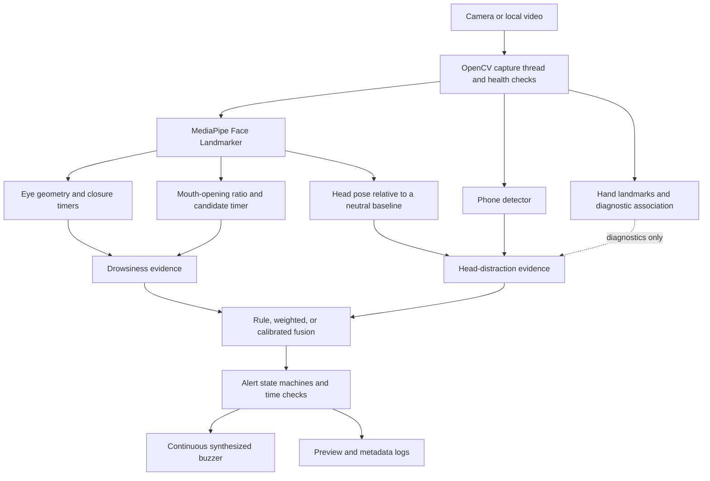

# DriveSentinel

> An AI-powered Driver Monitoring System that uses computer vision to identify signs of driver distraction and provide real-time audio warnings.

## 1. Project overview

DriveSentinel is a local Python prototype that processes webcam or video frames and looks for visual cues related to driver attention. It was developed to bring face, eye, mouth, and head-pose measurements into one configurable monitoring application.

The application shows its current measurements and can play an electronic warning when configured cues persist. It is a research and demonstration project. It has not been validated as a vehicle safety system and should not be relied on while driving.

## 2. Features

Implemented features:

- Camera and local-video capture through OpenCV.
- MediaPipe face landmarks used for eye, mouth, and head-pose measurements.
- Bilateral eye-aspect-ratio monitoring, sustained eye-closure timing, PERCLOS, and optional operator-started personal eye calibration.
- Sustained mouth-opening candidate detection. This is not a yawn classifier.
- Neutral-relative left/right head-turn and downward-head tracking with separate timers.
- Phone-presence detection in the configured driver region.
- Hand landmarks and phone/hand proximity as diagnostic information. Hand movement alone does not trigger an alarm.
- Separate drowsiness and distraction decisions, a preview, and JSONL run logs.
- One continuous synthesized piezo-style warning tone while an alert is active.

Planned work, not implemented as validated behavior, includes broader camera testing, measured accuracy and false-alarm rates, and evaluation with appropriately collected and labeled data.

## 3. How it works



The capture thread keeps a recent frame available to the processing loop. Face landmarks feed the eye, mouth, and head-pose modules. Phone detection is independent; hand landmarks are used for diagnostics and do not independently activate the buzzer. Temporal trackers apply configured durations before sustained cues reach the alert controller.

## 4. Technology stack

| Technology | Purpose |
| --- | --- |
| Python | Application and analysis tools |
| OpenCV | Camera/video capture, image conversion, and calibration |
| MediaPipe Tasks | Face landmarks, hand landmarks, and the default phone detector |
| NumPy | Landmark, pose, and audio calculations |
| PyYAML | YAML configuration files |
| SoundDevice / PortAudio | Continuous synthesized warning audio |
| ONNX Runtime (optional) | Alternative ONNX phone detector |
| scikit-learn and pandas (optional) | Fusion-model fitting and data workflows |
| psutil (optional) | Process resource samples in run logs |

## 5. Project structure

```text
.
├── configs/                 # Full and eye-first configurations
├── docs/                    # Validation, safety, and research templates
├── models/README.md         # Model download sources and SHA-256 values
├── src/dms/
│   ├── launcher.py           # repository-aware drive command
│   ├── app.py                # Integrated command-line application and preview
│   ├── alerts/               # Alert states, notifications, and audio controller
│   ├── capture/              # Threaded camera/video capture
│   ├── detectors/            # Face, eyes, mouth, pose, phone, and hands
│   ├── fusion/               # Rule, weighted, and calibrated decisions
│   ├── health/               # Capture watchdog and channel health
│   ├── telemetry/            # Asynchronous JSONL logging
│   ├── temporal/             # Closure, PERCLOS, and head-direction timers
│   └── tools/                # Camera and pose calibration commands
├── tests/                    # unittest coverage for timing, audio, and alerts
├── tools/                    # Smoke, replay, fitting, and evaluation utilities
├── pyproject.toml            # Package metadata and dependencies
├── requirements-runtime.in   # Runtime dependency input list
├── requirements-dev.in       # Runtime plus packaging tools
└── uv.lock                   # Locked dependency graph for uv
```

## 6. System requirements

- Python 3.11 or later, below 3.15, as declared in `pyproject.toml`. Python 3.11 is the version used for local validation.
- A webcam recognized by OpenCV, or a local video file. The default camera source is index `0`.
- A working audio output device for audible warnings.
- The face model for face, eye, mouth, and head-pose features. The full profile also uses the phone and hand model files described in [models/README.md](models/README.md).
- The software and dependencies were checked in the current macOS development environment. Linux and Windows have not been validated. Live-camera operation and physical audio playback remain unverified on the target setup.

Camera permissions, lighting, camera placement, and available audio devices can affect operation. No dedicated GPU is required by the current configuration, and no performance target is claimed.

## 7. Installation guide

### Step 1: Clone the repository

```sh
git clone https://github.com/anantkumarc/DriveSentinel.git
cd DriveSentinel
```

### Step 2: Create a virtual environment

Use Python 3.11 if available:

```sh
python3.11 -m venv .venv
```

### Step 3: Activate it

macOS/Linux:

```sh
source .venv/bin/activate
```

Windows PowerShell:

```powershell
.venv\Scripts\Activate.ps1
```

### Step 4: Install dependencies

The project uses `pyproject.toml` as its package manifest:

```sh
python -m pip install --upgrade pip
python -m pip install -e .
```

Alternatively, with `uv` installed, use the committed lock file:

```sh
uv sync --locked
```

Optional packages can be installed for additional workflows:

```sh
python -m pip install -e ".[phone,training,resources]"
```

### Step 5: Obtain model files

Download the model assets into `models/` using the sources and SHA-256 checks in [models/README.md](models/README.md). Model weights are intentionally excluded from Git; the face model is needed for the main face-processing path, while the phone and hand files enable those detectors in the full profile.

### Step 6: Run the application

```sh
drive
```

The editable installation adds `drive` to the active virtual environment's
command path. Activate that environment in a terminal, then `drive` can be
run from any working directory. It starts the full configuration with camera
source `0` and resolves project files relative to the cloned repository.
Optional command-line arguments can override the defaults.

To use a local video instead of a camera:

```sh
drive --source path/to/video.mp4 --headless
```

Press `q` in the preview to stop. Runs create a new directory under `runs/` with `manifest.json` and `observations.jsonl`; these local outputs are ignored by Git. On macOS, grant camera access to the terminal or application that starts the program.

## 8. Configuration

The application defaults to `configs/full.yaml`. `configs/minimal.yaml` provides an eye-first baseline. Pass `--config` to select a configuration; `--source` can override its camera source.

| Setting | Full-profile default | Meaning |
| --- | ---: | --- |
| `camera.source` | `0` | OpenCV camera index; a local video path can also be supplied on the command line |
| `camera.width`, `camera.height` | `640`, `480` | Requested capture size |
| `eyes.ear_closed_threshold` | `0.20` | Fixed eye-aspect-ratio closure threshold |
| `eyes.critical_closure_seconds` | `1.5` | Sustained closure time for the critical eye-closure path |
| `eyes.perclos_window_seconds` | `60.0` | PERCLOS observation window |
| `mouth.open_ratio_threshold` | `0.55` | Mouth-opening ratio for an open observation |
| `mouth.candidate_after_seconds` | `1.0` | Sustained opening time before a candidate is emitted |
| `head_distraction.left_yaw_threshold_deg`, `right_yaw_threshold_deg` | `15.0` | Head-turn activation angles |
| `head_distraction.head_turn_threshold_seconds` | `5.0` | Sustained left/right turn duration |
| `head_distraction.downward_pitch_threshold_deg` | `18.0` | Downward-pose activation angle |
| `head_distraction.downward_head_threshold_seconds` | `3.0` | Sustained downward-pose duration |
| `phone.score_threshold` | `0.20` | Minimum phone-detection score |
| `alerts.buzzer_frequency_hz` | `2400.0` | Synthesized warning-tone frequency |
| `alerts.buzzer_sample_rate_hz` | `48000` | Audio sample rate |
| `alerts.buzzer_volume` | `0.9` | Waveform amplitude setting |

Recovery angles, smoothing, detector confidence gates, phone ROI, fusion strategy, alert persistence, and other values are also configurable in the YAML files. Thresholds are engineering starting points, not validated safety limits.

## 9. Detection behaviour

| Cue | Implemented behavior |
| --- | --- |
| Forward head position | No head-direction warning while relative yaw and pitch remain within the configured range. A stable neutral baseline is enrolled at startup. |
| Left or right turn | Starts a separate turn timer after the corresponding yaw angle is crossed. The full profile alerts after more than 5 seconds. |
| Looking downward | Starts a down timer after the configured pitch angle is crossed. The full profile alerts after 3 seconds. Looking up uses the opposite pitch sign and is not a down cue. |
| Eye closure | Uses both eyes’ landmark geometry and a time-based closure tracker. The full profile has a 1.5-second critical-closure path. |
| Mouth opening | A 1-second sustained opening produces a yawn-like candidate. Talking can also meet this condition; the code does not classify yawns. |
| Phone | The full profile warns when a phone is detected in the configured driver region. This is phone-presence detection, not proof that the driver is using it. |
| Hand movement | Hand landmarks and association remain diagnostic; hand movement alone is not alarm evidence. |
| Audio | One synthesized, continuous 2.4 kHz piezo-style tone plays while an alert is active and stops when the alert clears. It uses the system’s selected audio output. |

## 10. Testing

Run the automated tests from the repository root:

```sh
python -m unittest discover -s tests
```

The local Python 3.11 run completed with all 30 tests passing.

Check imports and configured model loading with:

```sh
python tools/smoke.py --config configs/full.yaml --require-model
```

For manual checks, use a stationary camera and follow [the head-distraction validation procedure](docs/head-distraction-validation.md). Do not perform tests while driving. Automated timing tests do not establish real-camera detection accuracy, physical alert latency, or safety performance.

## 11. Limitations

- Camera quality, lighting, occlusion, camera position, and face angle affect landmark quality and pose estimates.
- The neutral-pose baseline and direction signs need checking with the intended camera placement.
- A detected phone in a broad region can belong to a passenger or be a false detection. Phone presence is not phone-use classification.
- Mouth opening can occur during speech and is not a yawn classifier.
- No real-driver accuracy, false-alarm rate, throughput, or physical warning-latency result has been established.
- This prototype is not certified vehicle-safety equipment and is not a replacement for attentive driving or qualified safety systems.

## 12. Future improvements

Possible future work includes a guided camera and neutral-pose setup, evaluation across more camera placements and lighting conditions, documented performance measurements, and privacy-reviewed collection of labeled data. These are plans, not completed capabilities.

## 13. Contributing

See [CONTRIBUTING.md](CONTRIBUTING.md) for the development and pull-request workflow. Changes to detection behavior should include tests and explain the thresholds or evidence used. Do not add private recordings, face images, credentials, or downloaded model weights to a pull request.

## 14. License

**No license has been selected for DriveSentinel.** No `LICENSE` file is included. Please choose a license before enabling reuse or redistribution under an open-source license.

## 15. Author

**Ananth Kumar A C**<br>
GitHub: [@anantkumarc](https://github.com/anantkumarc)

## 16. Additional documentation

- [Environment and verification notes](docs/environment.md)
- [Model sources and checksums](models/README.md)
- [Head-distraction validation](docs/head-distraction-validation.md)
- [Safe pilot protocol](docs/safe-pilot-protocol.md)
- [Analysis plan template](docs/analysis-plan-template.md)
