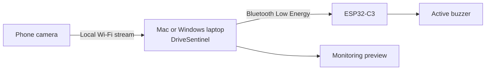
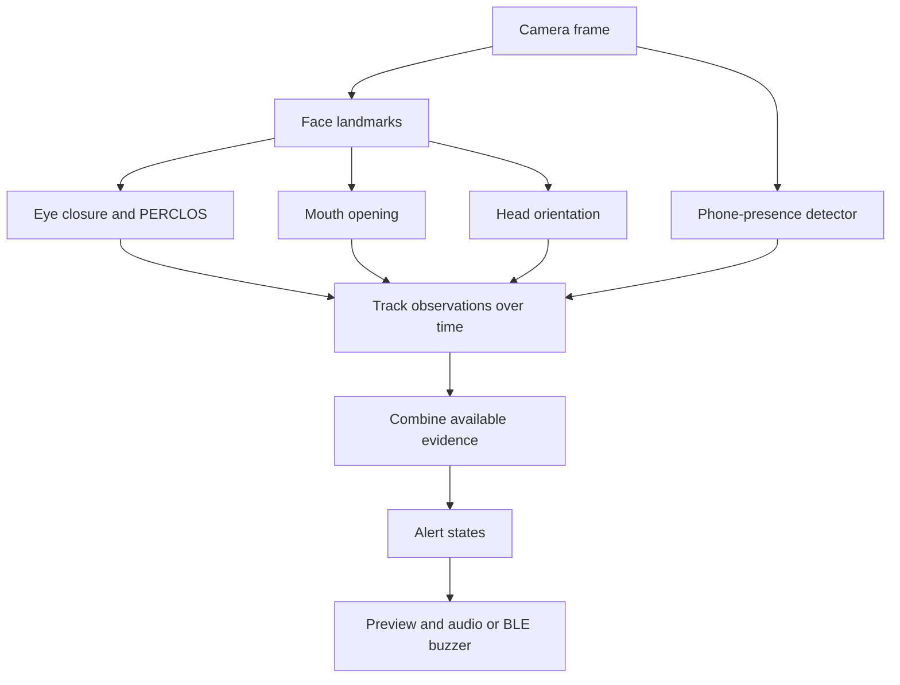

# DriveSentinel


**A local driver-monitoring research prototype** that uses a camera to track visual cues related to drowsiness and distraction, then provides configurable warnings.

> **Research use only.** DriveSentinel is not a certified vehicle safety system and must not be relied on while driving. Perform demonstrations and tests while the vehicle is stationary.

## Overview

Drivers may not notice prolonged eye closure or that their head has turned away from the road. DriveSentinel processes camera frames and tracks these cues over time. It can show a preview and sound an alert through the laptop or an optional ESP32-connected buzzer.



The phone camera and ESP32 are optional: a laptop webcam and laptop audio can also be used. The current firmware controls a buzzer; physical warning LEDs are a possible future addition.

## Features

| Feature | Current behavior |
| --- | --- |
| Eyes | Measures eye landmarks, tracks closure and calculates PERCLOS when sufficient observations are available. |
| Head position | Tracks sustained left, right and downward head movements relative to a neutral position. |
| Mouth | Reports sustained mouth opening as a candidate; it does not confirm yawning. |
| Phone | Detects phone presence in a configured image region; it does not establish phone use. |
| Alerts | Combines available cues into drowsiness and distraction states. Supports laptop audio or an optional ESP32 BLE buzzer. |
| Hand tracking | Provides diagnostics; hand movement alone does not trigger an alarm. |

Detection accuracy, false-alarm rates and physical warning latency have not been established. Windows and ESP32 hardware behavior have not been fully validated by this project.

## Installation

**Prerequisites:** [Python 3.11](https://www.python.org/downloads/), [Git](https://git-scm.com/downloads), and internet access for the initial setup. The recommended targets are Apple Silicon macOS 13+ and Windows x64. Intel Macs do not have a compatible wheel for the pinned MediaPipe version; Windows ARM64 and Windows hardware have not been validated.

### macOS

In Terminal, install once:

```bash
git clone https://github.com/anantkumarc/DriveSentinel.git
cd DriveSentinel
python3.11 setup_drive.py
```

To start the phone camera and ESP32 buzzer:

```bash
source .venv/bin/activate
drive wifi --ble
```

### Windows

In **Command Prompt**, install once:

```bat
git clone https://github.com/anantkumarc/DriveSentinel.git
cd DriveSentinel
py -3.11 setup_drive.py
```

To start the phone camera and ESP32 buzzer:

```bat
.venv\Scripts\drive.exe wifi --ble
```

Setup creates a virtual environment, installs the app and BLE support, and downloads verified model files. Wait for `Setup complete`. If a download fails, check your internet connection and run the setup command again.

## Run and configure

For the phone-and-ESP32 setup:

1. Enable the phone's hotspot and connect the laptop to it.
2. Open IP Webcam on the phone and start its server.
3. Power on the ESP32 with the [buzzer firmware](docs/esp32-ble-buzzer.md) uploaded, and enable Bluetooth on the laptop.
4. Run the platform's `wifi --ble` command above. Enter the address displayed on the phone when prompted; it is saved locally for next time.
5. Keep the camera still and look forward for a few seconds so the app can establish a neutral head position. Press **Q** to quit.

If the phone's address changes, provide the new address once with `drive wifi http://PHONE_ADDRESS:8080 --ble` (on Windows, use `.venv\Scripts\drive.exe` in place of `drive`). For the laptop webcam and audio, activate the environment and run `drive` without `wifi --ble`.

The full profile is [configs/full.yaml](configs/full.yaml). Its provisional defaults include **3 seconds** for sustained sideways or downward head movement, **1.5 seconds** for the critical eye-closure path, and **1 second** of phone-presence confirmation. These are configurable starting points, not validated safety limits. [configs/minimal.yaml](configs/minimal.yaml) provides an eye-first baseline.

Press **F** for fullscreen, **D** for detailed monitoring, **N** to reset the head baseline, or **Q** to quit. Laptop audio is disabled in BLE mode; check the preview and terminal for BLE connection status. See the [ESP32 wiring and setup guide](docs/esp32-ble-buzzer.md) before connecting a buzzer.

## How it works



| Term | Meaning in this project |
| --- | --- |
| **Eye Aspect Ratio (EAR)** | A ratio of distances between eye landmarks; it tends to decrease when an eye closes. |
| **PERCLOS** | The proportion of observed time classified as closed eyes within a rolling window. The full profile uses 60 seconds with a minimum coverage requirement. |
| **Head-pose estimation** | Estimates head orientation—turning, looking up/down and tilting—relative to a neutral reference. It is not eye-gaze detection. |
| **Temporal tracking** | Uses timestamps to determine whether a cue persists, rather than deciding from a single frame. |
| **Alert fusion** | Combines visual evidence using configurable rules, weights or supplied calibrated models. |
| **BLE warning** | The laptop sends standard Bluetooth Immediate Alert levels to the ESP32. The firmware switches the buzzer and has a timeout if updates stop. |

## Screenshots and demo

No genuine screenshots or demo video are included yet. Add a real, privacy-reviewed preview image or stationary demonstration here when available.

## Project structure

```text
configs/                  Monitoring and alert settings
docs/                     Hardware, validation and research guides
firmware/                 ESP32-C3 Arduino sketch
models/README.md          Model sources and checksums
src/dms/                  Capture, detection, alerts and BLE integration
tests/                    Automated checks
tools/                    Calibration and research utilities
setup_drive.py            Installation script
```

## Testing and documentation

With the virtual environment active, run:

```bash
python -m unittest discover -s tests
```

Automated checks do not establish real-camera accuracy or physical buzzer performance. See:

- [Advanced usage and detection details](docs/advanced-usage.md)
- [ESP32 BLE buzzer setup and wiring](docs/esp32-ble-buzzer.md)
- [Head-distraction validation](docs/head-distraction-validation.md)
- [Environment and verification notes](docs/environment.md)
- [Model downloads and checksums](models/README.md)
- [Safe pilot protocol](docs/safe-pilot-protocol.md)
- [Contributing](CONTRIBUTING.md)

## Limitations and privacy

Lighting, occlusion, camera placement and individual differences can affect detection. The default phone region covers the full image, so a detected phone may belong to a passenger or be a false detection. Validate camera placement and head-direction signs on the intended setup. The project does not save raw video, audio or landmark coordinates by default, but run logs contain derived monitoring data and should be treated as sensitive.

This is a prototype; it is not a replacement for attentive driving or a validated safety system. Broader hardware testing and evaluation across people and conditions remain future work.

## Author and license

**Ananth Kumar A C** · [GitHub](https://github.com/anantkumarc)

No license has been selected for this repository.
